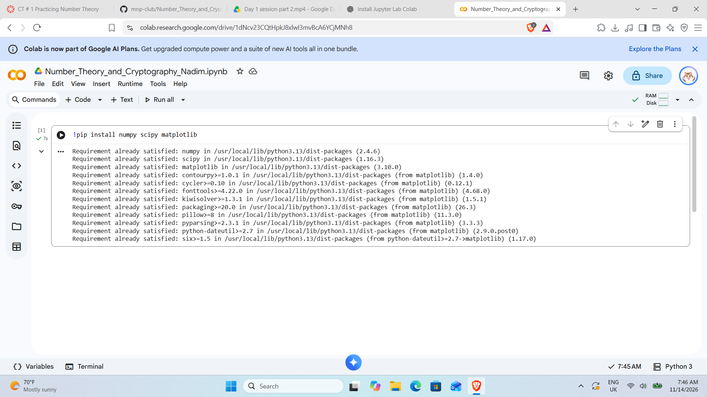
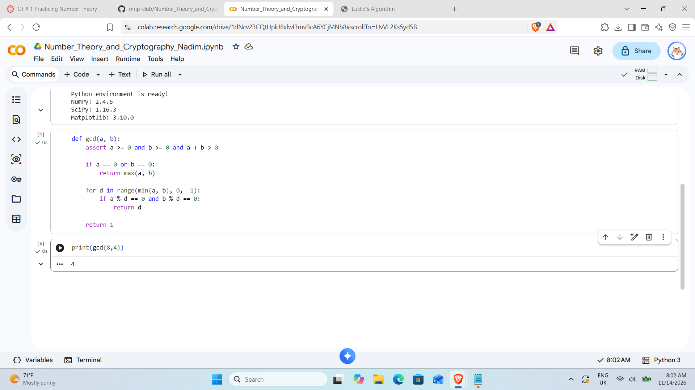
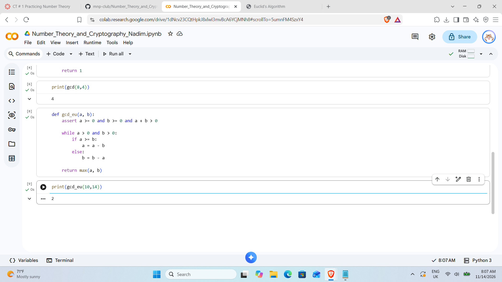
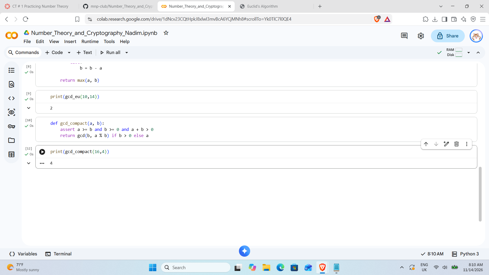

Md. Nadim Mahmud Borad

IT23012
---

## Day 0: Fundamentals of Number Theory

We covered the basic concepts of number theory and modular arithmetic.

### 1. Divisibility

**Definition:** $b \mid a$ (b divides a) if there exists an integer $k$ such that:

$$
a = b \times k
$$

**Lemma 1:** If $c \mid a$ and $c \mid b$, then:

$$
c \mid (a \pm b)
$$

**Proof:**

Let $a = ck_1$ and $b = ck_2$.

$$
\begin{aligned}
a \pm b &= ck_1 \pm ck_2 \\
        &= c(k_1 \pm k_2)
\end{aligned}
$$

Therefore, $c \mid (a \pm b)$.

**Lemma 2:** If $b \mid a$, then $b \mid (a \times c)$ for any integer $c$.

**Proof:**

Let $a = bk$.

$$
\begin{aligned}
a \times c &= bk \times c \\
           &= b(k \times c)
\end{aligned}
$$

Therefore, $b \mid (a \times c)$.

### 2. Division with Remainder

For $b > 0$, any integer $a$ can be expressed as:

$$
a = q \times b + r
$$

Where:

- $q$ = Quotient
- $r$ = Remainder
- $0 \leq r < b$

**Key Lemma:** Two integers $a_1$ and $a_2$ have the same remainder modulo $b$ if and only if:

$$
b \mid (a_1 - a_2)
$$

### 3. Congruence

$$
a \equiv b \pmod m
$$

This means that $a$ and $b$ have the same remainder when divided by $m$.

Equivalently:

$$
m \mid (a-b)
$$

**Important Properties:**

- Every number is congruent to its remainder modulo $m$.
- Every number is congruent to $a + k \times m$, where $k$ is any integer.

### 4. Rules of Modular Arithmetic

| Rule | Statement |
|---|---|
| Add a constant | $a \equiv b \Rightarrow a+c \equiv b+c$ |
| Addition | $a \equiv b,\ c \equiv d \Rightarrow a+c \equiv b+d$ |
| Multiply by a constant | $a \equiv b \Rightarrow ac \equiv bc$ |
| Multiplication | $a \equiv b,\ c \equiv d \Rightarrow ac \equiv bd$ |

---

## Day 1: GCD and Euclidean Algorithm

I install NumPy 2.4.6, SciPy 1.16.3, Matplotlib 3.10.0 in google colab.

Topics covered on Day 1:

### 1. Naive Algorithm

### 2. Euclid's Lemma

### 3. Compact Code

---

